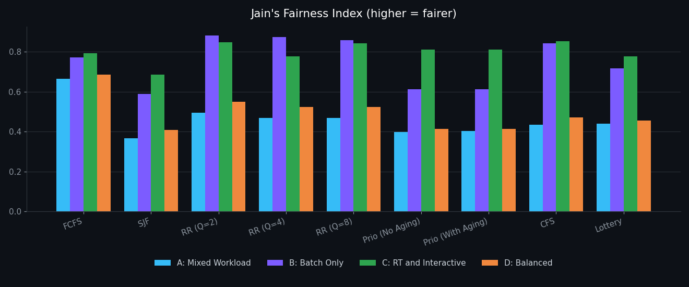
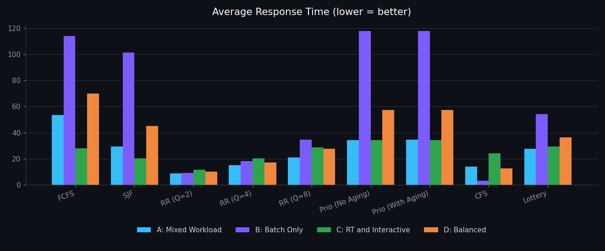

<h1 align="center">CPU Scheduling Fairness Simulator</h1>

<p align="center">
  A C simulator that compares 9 CPU scheduling configurations across 4 workload scenarios, measuring speed <i>and</i> fairness.
  <br/>CSC308 Operating Systems · Abu Dhabi University
</p>

<p align="center">
  
  
  
  
</p>

<p align="center"></p>

## Overview

Schedulers are usually judged on how fast they finish work. This project also asks **how evenly they treat processes**. Each algorithm runs on the same generated workloads, and the simulator reports average waiting, turnaround and response time, CPU utilization, and **Jain's Fairness Index** computed over turnaround times:

$$J = \frac{(\sum x_i)^2}{n \cdot \sum x_i^2}$$

## Algorithms

| # | Algorithm | Notes |
|---|---|---|
| 1 | **FCFS** | First come, first served |
| 2 | **SJF** | Shortest job first (non-preemptive) |
| 3 | **Round Robin** | Quantum = 2, 4 and 8 |
| 4 | **Priority** | With and without aging |
| 5 | **CFS** | Linux-style Completely Fair Scheduler (virtual runtime) |
| 6 | **Lottery** | Probabilistic ticket-based scheduling |

## Workload scenarios

Three process types are generated: **Interactive** (1–5 ms bursts, medium priority), **Batch** (20–50 ms bursts, low priority) and **Real-Time** (3–10 ms bursts, highest priority).

| Scenario | Mix |
|---|---|
| **A** | Mixed: interactive + batch + real-time |
| **B** | Batch only |
| **C** | Real-time and interactive heavy |
| **D** | Balanced, equal thirds |

## Key findings

- **SJF minimizes waiting time** in every scenario (for example 29.5 vs 53.4 for FCFS in A), but it is often the **least fair**, scoring 0.37 in A.
- **Round Robin and CFS give the fastest response.** CFS reached a 3.07 average response on batch-only work, and RR (Q=2) led A, C and D.
- **Fairness depends on the workload.** RR (Q=2) is fairest for batch-only work (0.88), CFS for real-time and interactive work (0.85), and FCFS for mixed and balanced loads.
- **Aging barely changed results** for these workloads, so starvation was not a limiting factor at this scale.
- **There is a clear trade-off.** Algorithms that cut average wait tend to do it by favoring short jobs, which lowers fairness.

<p align="center"></p>

Full numbers are in [`results/results.csv`](results/results.csv).

## Build and run

```bash
make run
```

Or compile manually:

```bash
gcc -o simulator main.c process.c workload.c metrics.c \
    scheduler_fcfs.c scheduler_sjf.c scheduler_rr.c \
    scheduler_priority.c scheduler_advanced1.c scheduler_advanced2.c -lm
mkdir -p results && ./simulator
```

The simulator prints a results table for each scenario and writes everything to `results/results.csv`.

## Code structure

| File | Purpose |
|---|---|
| `main.c` | Runs every algorithm on every scenario and prints and saves results |
| `process.c/.h` | Process model (type, burst, priority, timing fields) |
| `workload.c/.h` | Scenario generators A–D |
| `metrics.c/.h` | Waiting, turnaround and response time, utilization, Jain's index |
| `scheduler_fcfs.c` · `scheduler_sjf.c` · `scheduler_rr.c` · `scheduler_priority.c` | Classic algorithms |
| `scheduler_advanced1.c` | CFS |
| `scheduler_advanced2.c` | Lottery scheduling |

---

<p align="center"><a href="https://github.com/loliamro">github.com/loliamro</a> · <a href="https://www.linkedin.com/in/amrjallad/">LinkedIn</a></p>
